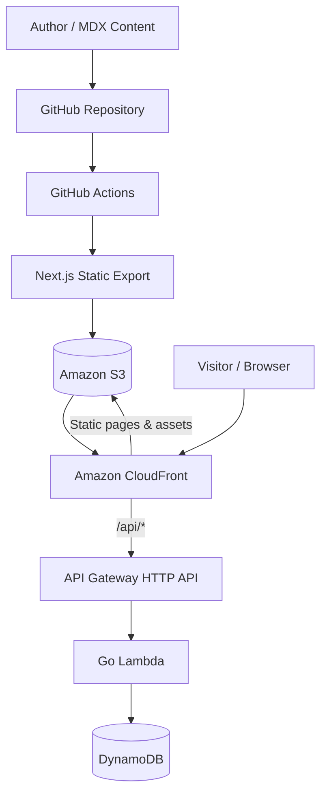

<div align="center">

# 🪐 OrbitForge

### 星轨实验室 · Personal AI & Engineering Lab

**Explore the Unknown. Engineer the Future.**  
**探索未知，构建未来。**

一个面向 **AI 开发、模型训练、软件工程与系统架构** 的个人技术实验室。  
在这里记录技术文章、工程实践、研究实验，以及值得分享的设计思考。

**`AI Engineering` · `Machine Learning` · `Distributed Systems` · `System Architecture` · `Creative Coding`**

> 🚧 **Project Status: Planning / Early Development**  
> 项目正在规划与初始化中。以下功能与技术方案为开发目标，不代表当前仓库已全部实现或部署上线。

</div>

---

## ✨ About OrbitForge

**OrbitForge** = **Orbit（探索的轨道）** + **Forge（创造与锻造）**。

它不只是一个发布文章的个人博客，而是一个持续迭代的 **Developer Lab**：

- **Knowledge / 技术文章**：深入记录 AI 应用开发、模型训练、编程实践、工具使用和技术探讨。
- **Experiments / 实验记录**：整理机器学习实验、性能对比、可视化结果和有趣的技术 Demo。
- **Blueprints / 架构设计**：分享分布式系统、云原生、Serverless 和 AI Agent 架构中的设计取舍。
- **Projects / 开源项目**：展示个人项目、工程实践与可复用工具。
- **Thoughts / 设计思考**：记录探索过程中的想法、问题、失败经验与新的可能性。

## 🎨 Design Philosophy

网站采用 **Future Tech Lab（未来科技实验室）** 设计语言：

| 设计元素 | 方向 |
| --- | --- |
| 视觉基调 | 深空黑、赛博青、电光紫，辅以克制的信号绿 |
| 首页体验 | 科技感 Hero、Bento Grid、轻量星空/粒子、玻璃拟态卡片 |
| 文章阅读 | 简洁排版、清晰目录、代码高亮、架构图与公式优先 |
| 交互风格 | 流畅微动效、可选终端彩蛋，支持减少动效偏好 |
| 响应式 | Desktop / Tablet / Mobile 全端适配 |

> **Make the homepage expressive. Keep the reading experience focused.**  
> 首页可以炫酷，技术文章必须好读。

## 🧭 Planned Pages

| Route | 页面 | 内容 |
| --- | --- | --- |
| `/` | **Home** | 个人介绍、研究方向、精选文章、近期项目与实验 |
| `/articles` | **Articles** | 技术文章、分类、标签、搜索与系列专题 |
| `/articles/[slug]` | **Article** | MDX 正文、代码块、Mermaid、数学公式、文章目录 |
| `/lab` | **AI Lab** | 模型实验、训练指标、交互式 Demo 与实验记录 |
| `/architecture` | **Architecture** | 系统架构、设计图、数据流与技术决策 |
| `/projects` | **Projects** | 个人项目、技术栈、源码与演示入口 |
| `/about` | **About** | 个人介绍、技术兴趣、联系方式 |

## 🧰 Tech Stack (Planned)

### Frontend & Content

- **Next.js + React + TypeScript** — 应用框架与组件体系
- **Tailwind CSS + shadcn/ui** — 样式与可定制 UI 组件
- **Motion / React Three Fiber（按需）** — 动效与科技视觉
- **MDX + Git** — 版本化文章内容与发布工作流
- **Shiki、Mermaid、KaTeX** — 代码高亮、架构图和公式
- **静态生成 / Static Export** — 尽量将公开内容预渲染为静态页面

### Backend & Cloud

- **Go + AWS Lambda** — 按需承载动态业务 API
- **Amazon API Gateway (HTTP API)** — 对外提供 HTTP 接口
- **Amazon DynamoDB** — 反馈、订阅等动态数据（按需启用）
- **Amazon S3 + CloudFront** — 静态资源与全球分发
- **AWS CDK (TypeScript)** — 基础设施即代码（计划）
- **GitHub Actions + AWS OIDC** — 自动测试、构建与部署（计划）

**核心原则：文章静态生成，动态能力交给 Go Lambda。** 首期不计划搭建独立 CMS、用户账户体系或常驻 Node.js 服务。

## 🏗️ Architecture (Target)



此图为**计划中的逻辑架构**。实际部署时，CloudFront 将通过不同 Origin 分别处理静态资源与 `/api/*` 请求；静态页面深链接的 URI 重写也需单独配置。

## 📁 Project Structure (Proposed)

```text
orbitforge/
├── frontend/                 # Next.js + React + TypeScript
│   ├── src/
│   │   ├── app/              # App Router pages
│   │   ├── components/       # UI / blog / effects / lab
│   │   ├── lib/              # Content, search, SEO, API clients
│   │   └── styles/
│   ├── content/
│   │   ├── articles/         # Technical articles (MDX)
│   │   ├── experiments/      # AI / ML experiment notes
│   │   └── projects/         # Project metadata
│   └── public/
├── backend/                  # Go Lambda functions & services
│   ├── cmd/
│   └── internal/
├── infrastructure/           # AWS CDK / IaC
├── docs/                     # Architecture, ADRs, guides
└── README.md
```

> 这是目标目录结构。项目尚处于初始化阶段，最终结构会随着实际开发调整。

## 🚀 Getting Started

目前仍处于项目初始化阶段，**尚未提供保证可执行的一键启动步骤**。

前端脚手架落地后，预计采用以下本地开发流程：

```bash
cd frontend
npm install
npm run dev
```

然后访问 `http://localhost:3000`。

**注意：** 以上命令是计划采用的开发方式，需在 `frontend/` 和对应 `package.json` 创建后才能使用。Go 后端、AWS 环境及部署脚本会在相应开发阶段补充独立文档。

## 🗺️ Roadmap

### Phase 0 · Foundation

- [ ] 初始化 Next.js + TypeScript 项目及代码规范
- [ ] 确定品牌、设计 Token、目录与文章 URL 规则
- [ ] 接入并验证 MDX 内容渲染和静态导出

### Phase 1 · Blog MVP

- [ ] 首页、文章列表、文章详情、Projects、About
- [ ] 代码高亮、目录、Mermaid、KaTeX、标签和搜索
- [ ] SEO、RSS、sitemap、Open Graph、404
- [ ] 移动端适配与无障碍基础体验
- [ ] S3 + CloudFront 静态部署、CI/CD

### Phase 2 · Future Tech Experience

- [ ] 首页星空/粒子与玻璃拟态动效
- [ ] Bento 风格卡片与交互式技术栈展示
- [ ] 可选终端交互与动画性能优化

### Phase 3 · Serverless APIs

- [ ] Go Lambda + API Gateway + DynamoDB 基础设施
- [ ] 文章反馈、联系表单等动态功能（按需求实现）
- [ ] 日志、监控、限流与安全加固

### Phase 4 · AI Lab

- [ ] 实验记录、指标图表与模型结果展示
- [ ] 可交互架构图和技术 Demo
- [ ] 关联文章、项目、实验，形成完整知识体系

## 📝 Writing & Publishing (Planned)

技术文章计划采用 **MDX + Frontmatter**，以 Git 为主要内容管理和版本管理方式：

1. 在 `frontend/content/articles/` 新增或编辑 MDX 文章。
2. 本地预览，检查代码示例、图片、公式和架构图。
3. 提交 Pull Request 或推送到指定分支。
4. CI 校验通过后，自动构建并发布静态页面。

发布规范、Frontmatter 字段和文章模板将在内容系统完成时提供。

## 🔎 Open-Source Inspirations

OrbitForge 将参考以下开源项目的工程与视觉设计，但不会直接将两个仓库简单拼接：

- **[Ahnafnafee.dev](https://github.com/ahnafnafee/ahnafnafee.dev)** — 参考技术博客、MDX 内容管理和 SEO 工程结构。
- **[Anvians Portfolio](https://github.com/Anvians/Portfolio)** — 参考未来科技实验室视觉、3D 星空、玻璃卡片和动态交互。

复用第三方代码、组件或素材时，将检查对应版本许可证并保留必要的版权与署名说明。

## 🤝 Contributing

OrbitForge 目前以个人项目形式建设。欢迎通过 **Issues** 交流技术方案、提出改进建议或分享有意思的技术想法。贡献流程将在代码基础稳定后补充。

## 📄 License

**待确定（TBD）。** 在仓库添加正式 `LICENSE` 文件之前，请勿假定 OrbitForge 源码已获 MIT、Apache-2.0 或其他开源许可授权。

---

<div align="center">

**OrbitForge · 星轨实验室**  
*Explore the Unknown. Engineer the Future.*

**Built with curiosity, code, and an engineering mindset.**

</div>
