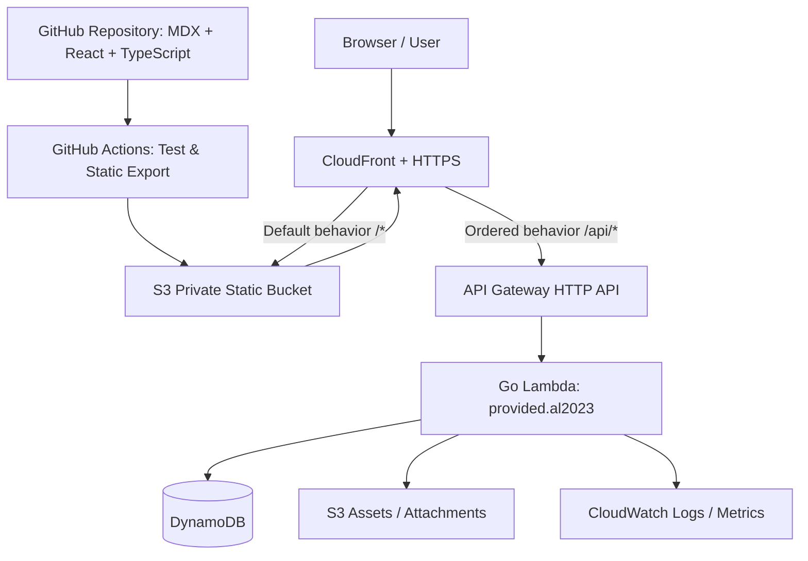

# 个人技术博客建设方案：AI Engineering Lab

> **文档类型**：产品规划 + UI/UX 设计规范 + 前后端技术设计 + AWS Serverless 部署方案 + 实施计划  
> **版本**：V1.0  
> **整理日期**：2026-11-04  
> **项目状态**：规划阶段  
> **适用对象**：个人开发者 / AI 应用开发者 / 模型训练及系统架构研究者  
> **项目暂定名**：**AI Engineering Lab**（名称、Logo、域名均可在开发前调整）

---

## 0. 执行摘要

### 0.1 项目定位

建设一个**具有个人辨识度的未来科技实验室风格技术博客**。它不仅承载技术文章，也是一个可持续更新的个人工程知识库、模型实验室、系统架构展示空间和开源项目入口。

网站需要同时达成两种看似矛盾的目标：

1. **首页足够独特**：深空黑背景、赛博青/电光紫配色、细腻的 3D 粒子、玻璃拟态卡片、交互式终端等，让访问者快速感知 AI 与工程技术特征。
2. **技术阅读足够专业**：文章页弱化装饰，强化代码高亮、架构图、数学公式、段落导航、可读性、搜索与 SEO，支持长篇技术分享。

### 0.2 技术路线（已确定）

| 维度 | 方案 | 说明 |
|---|---|---|
| 前端 | **Next.js + React + TypeScript** | App Router；以静态生成/静态导出为主要部署模式 |
| 样式 | Tailwind CSS + shadcn/ui / Radix | 高定制、低耦合；统一设计令牌 |
| 动效 | Motion（原 Framer Motion）+ 选择性 React Three Fiber | 只在首页和实验室必要区域启用重特效 |
| 内容 | **Git + MDX + Frontmatter** | 无需在第一版建设独立 CMS |
| 内容能力 | Shiki/Prism、Mermaid、KaTeX、代码复制 | 具体高亮库以主模板现有实现为准 |
| 后端 | **Go + AWS Lambda** | 仅承载需要运行时数据的 API |
| API | Amazon API Gateway HTTP API | 推荐使用 `/api/v1` 路径前缀 |
| 持久化 | DynamoDB | 反馈、订阅状态、访问统计等按需启用 |
| 静态资源 | S3 + CloudFront | 私有 S3 Origin，CloudFront OAC 访问 |
| DNS / 证书 | Route 53（可选）+ ACM | CloudFront 使用 `us-east-1` 区域的 ACM 证书 |
| IaC | AWS CDK（TypeScript） | 或团队熟悉的 OpenTofu / Terraform，首期只选一种 |
| CI/CD | GitHub Actions + AWS OIDC | 构建、测试、静态文件发布与基础设施部署 |

**最终建议：以 `ahnafnafee/ahnafnafee.dev` 为博客工程基础，参考 `Anvians/Portfolio` 的视觉表现并按需移植组件。** 不建议直接合并两个仓库，也不建议为了特效从零重写成熟的 MDX 博客功能。

### 0.3 核心决策及非目标

- 首期文章采用 **MDX 静态生成**，编辑文章即提交 Git；发布触发重新构建。
- 首期 **不做文章管理后台、不做账号注册系统、不做复杂权限系统**。
- Go Lambda 的存在不意味着文章必须从后端动态加载。**SEO 和阅读体验优先**。
- 首期不承诺 GPU 在线训练、在线运行任意用户代码；AI Lab 首期侧重**实验展示与前端交互可视化**。
- 不堆叠全屏动效；控制浏览器资源占用，移动设备和偏好减少动画的用户要有降级路径。

---

## 1. 开源项目选型与复用策略

### 1.1 主选项目：Ahnafnafee.dev

- **源码**：https://github.com/ahnafnafee/ahnafnafee.dev
- **线上预览**：https://ahnafnafee.dev/
- **技术**：Next.js、React、TypeScript、Tailwind CSS、MDX
- **许可证**：仓库 README 标注 **MIT**；使用前以锁定的 commit 中 `LICENSE` 文件为准。
- **适合原因**：拥有博客、作品集、研究内容、SEO 结构化数据、代码高亮、Mermaid、KaTeX、站点地图、文章关联、自动化测试等能力；README 提供静态导出命令。

**复用内容**：内容读取、文章详情页逻辑、路由结构、SEO/JSON-LD、OG 基础、MDX 组件、文章列表、RSS / sitemap、搜索可扩展点、测试与脚本。

**需要清理或替换**：原作者的身份信息、链接、站点图标、研究资料、现有内容；与 Vercel 服务端 API/Analytics/图片优化绑定的部分；与目标部署不兼容的 Server Actions、运行时路由和动态服务。

> **特别注意**：该项目采用特殊的静态导出脚本，在导出前临时移走不能静态导出的 API 路由。迁移后应通过 `yarn export`（或按实际仓库脚本调整）完整验证，不能想当然地直接切换 `next.config` 就视为部署完成。

### 1.2 视觉参考项目：Anvians / Portfolio

- **源码**：https://github.com/Anvians/Portfolio
- **线上预览**：https://ankitsharma-anvians.vercel.app/
- **技术**：Next.js、Tailwind CSS v4、React Three Fiber、Three.js、Motion；原项目部分组件为 JavaScript
- **许可证**：仓库标注 **MIT**。
- **适合原因**：3D 星空、Bento 卡片、玻璃拟态、未来操作系统风格、悬浮导航、交互终端、项目预览。

**建议移植的部分**：`StarBackground` 视觉理念、玻璃卡片组件、Hero 立体层次、Bento 网格、悬浮导航、Terminal 彩蛋。迁入时将代码改为 TypeScript，重构样式令牌与可访问性。

**不建议直接照搬的部分**：长时间运行的重粒子特效、自定义鼠标指针（移动端不适用）、所有页面统一霓虹发光、大量 iframe 预览、可能对阅读形成干扰的 Glitch 效果。

### 1.3 后备方案

| 项目 | 地址 | 适用情况 |
|---|---|---|
| Tailwind Next.js Starter Blog | https://github.com/timlrx/tailwind-nextjs-starter-blog | 若主模板改造成本过高，优先稳定的 MDX 博客能力 |
| Stosiu Developer Portfolio | https://github.com/Stosiu/nextjs-developer-portfolio | 偏开发者工作台、终端和个人技术展示时参考 |
| Amir's Portfolio | https://github.com/sconderg/portfolio | 参考克制的交互动效与文章阅读体验 |

**开源合规原则**：

1. 将选用的源仓库 commit SHA 记录在 `docs/OPEN_SOURCE_ATTRIBUTIONS.md`。
2. 保留原始项目许可与版权声明，核对字体、图片、图标、二次引入组件的独立许可。
3. 不直接保留原作者的肖像、姓名、个人文章或其他受保护的品牌素材。
4. 每次升级模板或引入新的第三方库，重新核对许可证与兼容性。

---

## 2. 网站定位与内容规划

### 2.1 目标受众

- AI 应用开发工程师、模型训练与推理工程师；
- Python、Go、TypeScript 开发人员；
- 对分布式系统、架构设计、云原生、可观测性感兴趣的开发者；
- 想理解某个工具如何真正用于工程项目的技术读者；
- 关注有趣创意、交互设计和个人实验项目的访问者。

### 2.2 内容支柱

| 一级栏目 | 主要内容 | 建议文章形式 |
|---|---|---|
| AI Engineering | LLM 调用、Agent、RAG、模型服务、推理优化 | 方案比较、教程、代码实战 |
| Model Training | 数据集、训练过程、实验记录、CV/LLM 微调 | 实验报告、曲线、失败分析 |
| Programming | Go、Python、TypeScript、工程实践 | 工具教程、排障、最佳实践 |
| Architecture | 消息队列、任务调度、分布式系统、观测与设计决策 | 架构解析、设计权衡、ADR |
| Tools & Workflow | 开发环境、CLI、Docker、AWS、效率工具 | 安装使用、场景评测、踩坑记录 |
| Ideas & Design | 有意思的设计思路、交互原型、技术实验 | 灵感随笔、探索文章、可交互演示 |

**内容原则**：优先原创实践和可复现过程，明确区分事实、推测和个人观点。文章要有「背景—问题—方案—实现—实验/结果—局限—总结」，不为追求发布频率制造空泛内容。

### 2.3 推荐的文章系列（待撰写选题，不代表已有文章）

1. **从零设计 AI 任务执行系统**：入口网关、异步任务、队列、Worker、超时和幂等。
2. **生产级模型服务实践**：部署、限流、监控、GPU 资源与推理成本。
3. **CV 训练手记**：数据准备、标注、训练、验证、实验追踪。
4. **Go + Lambda Serverless 实战**：HTTP API、DynamoDB、发布与可观测性。
5. **工程师工具箱**：命令行、开发环境、AI 辅助编码工具。
6. **架构设计札记**：为什么采用某种方案、备选是什么、代价在哪里。

### 2.4 个人品牌建议

- **品牌名称（暂定）**：AI Engineering Lab。
- **英文一句话**：`Building Intelligence. Engineering Systems.`
- **中文一句话**：`探索智能，构建系统，记录每一次工程实验。`
- **品牌语气**：理性、探索、工程导向、不过度包装。
- **识别元素**：轨道/神经网络节点/六边形结构组成的抽象 Logo；避免直接复制其他项目的徽标。

---

## 3. 信息架构、导航与页面清单

### 3.1 顶部导航

`Home` · `Articles` · `AI Lab` · `Architecture` · `Projects` · `About`

右上角固定显示：搜索入口、GitHub 链接、主题/动效设置（如需要）。桌面端采用浮动/半透明导航，移动端使用抽屉菜单，导航始终可访问而不遮挡正文。

### 3.2 路由规划

| 路由 | 页面 | 优先级 | 生成策略 |
|---|---|---|---|
| `/` | 个人实验室首页 | P0 | 静态 |
| `/articles/` | 文章列表与筛选 | P0 | 静态 + 前端交互 |
| `/articles/[slug]/` | 文章详情 | P0 | 构建时按 MDX 生成静态页 |
| `/tags/[tag]/` | 标签文章聚合 | P0 | 构建时生成 |
| `/projects/` | 项目列表 | P0 | 静态 |
| `/projects/[slug]/` | 项目详情 | P1 | 静态 |
| `/lab/` | AI 实验室入口 | P1 | 静态 + Client Components |
| `/lab/[slug]/` | 实验详情与 Demo | P1 | 静态外壳 + 客户端图表 |
| `/architecture/` | 架构图谱/文章索引 | P1 | 静态 |
| `/architecture/[slug]/` | 架构设计详情 | P1 | 静态 |
| `/about/` | 个人介绍、技术栈、联系 | P0 | 静态 |
| `/search/` | 全站搜索 | P0 | 前端索引搜索 |
| `/404/` | 404 页面 | P0 | 静态 |
| `/privacy/` | 隐私与数据说明 | P1 | 静态 |

> 动态路由在静态导出模式下必须通过 `generateStaticParams()` 预先生成；新增文章通过重建发布。路由 URL 统一采用结尾 `/`，与 S3 输出目录和 CloudFront 重写策略保持一致。

---

## 4. UI/UX 设计规范：未来科技实验室风

### 4.1 视觉基调

关键词：**Deep Space / Digital Research Lab / Cyber Cyan / Violet Energy / Glass / Grid / Precision**。

整体坚持“**首页展示科技感，阅读页强调内容**”的分层设计。

| Token | HEX | 用途 |
|---|---|---|
| `bg.primary` | `#070D19` | 全站深空黑主背景 |
| `bg.surface` | `#101E32` | 卡片、面板 |
| `bg.elevated` | `#14283F` | 悬浮控件、二级面板 |
| `accent.cyan` | `#38D9F5` | 主要操作与交互强调 |
| `accent.violet` | `#906BFA` | 次要强调、研究/实验标签 |
| `state.success` | `#70E2AF` | 状态正常（非普通标题颜色） |
| `text.primary` | `#F3F8FF` | 文章正文标题/重要文案 |
| `text.secondary` | `#9BB3CB` | 次级说明 |
| `border.default` | `#22364C` | 面板边框 |

**色彩使用原则**：青色仅用于高价值交互和科技视觉节点；紫色做辅助，避免整页同时大面积发光。确保正文与背景有足够对比度。

### 4.2 排版、间距与组件

- 中文正文：系统中文字体优先（如 Noto Sans SC 可选），避免首屏等待超大字库下载。
- 英文/界面：Inter 或等效无衬线字体；代码：JetBrains Mono / 等宽字体。
- 正文内容宽度建议 `720–800px`，中文技术长文可按实际行长调整。
- 文章正文行高约 `1.75–1.9`，代码块字体以可读性为先。
- 使用 4/8px 基础间距系统；卡片圆角建议 12–20px，避免样式失控。
- 组件分类：`GlassCard`、`TechBadge`、`SectionHeading`、`ArticleCard`、`ExperimentCard`、`ProjectCard`、`CodeBlock`、`MermaidViewer`、`TableOfContents`、`MetricPanel`。
- 文章正文禁用自定义鼠标、持续扫描线、强制 Glitch、铺满整页的交互粒子。

### 4.3 动效分级

| 等级 | 场景 | 建议行为 |
|---|---|---|
| L0 | 正文、表单、读屏器模式 | 无装饰性动画 |
| L1 | 卡片 Hover、导航切换 | 150–250ms 微动效 |
| L2 | 首页局部面板、Bento 模块 | 低频渐入/位移/渐变 |
| L3 | 首页 Hero 星空/轨道交互 | 客户端懒加载、按性能降级 |

- 支持 `prefers-reduced-motion`，必要时提供“减少动效”开关。
- Canvas/WebGL 在页面不可见、后台标签页、低性能设备时暂停或降级。
- 3D 场景只在首页指定区域加载，不作为正文背景的强依赖。
- 对 Three.js 进行动态导入；保留静态渐变或 SVG 背景作为无 WebGL 时的降级方案。

### 4.4 响应式设计

- **Desktop ≥ 1200px**：宽屏 Hero、Bento 组合、文章三栏布局。
- **Tablet 768–1199px**：两列/单列混合；文章目录切换为抽屉。
- **Mobile < 768px**：单列布局、简化特效、导航抽屉；正文不横向溢出。
- 代码块允许水平滚动；架构图支持缩放与全屏查看，不缩到不可读。

### 4.5 页面视觉骨架

```text
┌──────────────────────────────────────────────────────────────┐
│  ◉ AI ENGINEERING LAB                ARTICLES  LAB  PROJECTS │
├──────────────────────────────────────────────────────────────┤
│                                                            │
│  Building Intelligence.           低密度星空 / 轨道 / 网格   │
│  Engineering Systems.                                      │
│  AI / ML · GO · PYTHON · DISTRIBUTED SYSTEMS                │
│  [Explore Articles]   [View Projects]                      │
│                                                            │
├──────────────────────────────────────────────────────────────┤
│   AI ENGINEERING      MODEL TRAINING       SYSTEM DESIGN    │
├──────────────────────────────────────────────────────────────┤
│   FEATURED ARTICLES ───────────────────────────── View All  │
│   精选技术文章 / 系列专题 / 最近更新                          │
├──────────────────────────────────────────────────────────────┤
│   RESEARCH LAB       ARCHITECTURE GALLERY    OPEN SOURCE    │
├──────────────────────────────────────────────────────────────┤
│   ABOUT / TECH STACK / NOW / SOCIAL LINKS                   │
└──────────────────────────────────────────────────────────────┘
```

---

## 5. 页面详细产品需求（PRD）

### 5.1 首页 Home — `/`

**目标**：在 10 秒内说明“我是谁、在研究什么、有哪些值得看的内容”。

**模块顺序**：

1. 顶部品牌导航 + GitHub/搜索入口；
2. Hero：一句话价值主张、专业方向标签、2 个主 CTA、可控星空/轨道动画；
3. 当前关注方向：AI Engineering、Model Training、System Architecture、Programming；
4. Featured Articles：人工指定 3–6 篇精选技术文章；
5. Latest Notes：最新 3–5 篇技术文章；
6. AI Lab Preview：展示 2–3 个有趣的实验或可视化；
7. Architecture Gallery：架构设计卡片与详情入口；
8. Projects：开源仓库、项目功能、技术栈；
9. About Mini：个人简介、技术栈、联系入口；
10. 页脚：RSS、GitHub、隐私说明、版权及致谢。

**交互原则**：主路径是“阅读文章”和“看项目”；终端交互作为可选彩蛋，不阻挡正常导航。

### 5.2 文章列表 Articles — `/articles/`

**P0 功能**：

- 按发布时间排序，支持精选优先、最近更新；
- 按分类和标签筛选；
- 标题、摘要、发布日期、更新时间、阅读时长、标签；
- 搜索框支持标题、摘要、标签检索；
- URL 可分享筛选状态（如 `?tag=go`）；
- 分页或“加载更多”，避免一次加载过多封面/卡片。

**P1 扩展**：按系列、按年度归档，关联项目和实验笔记。

### 5.3 文章详情 — `/articles/[slug]/`

**桌面布局**：左侧文章元信息 / 中间正文 / 右侧吸顶目录。小屏时左侧并入文章头部，目录折叠。

必需模块：

- 面包屑、文章标题、摘要、标签、发布日期/更新时间；
- 预计阅读时间、文章版本；
- Markdown/MDX：标题、列表、表格、引用、提示框、图片、视频嵌入（受控）；
- 代码块：语言标识、语法高亮、复制按钮、长代码折叠；
- Mermaid 架构图、KaTeX 公式、图片放大；
- 右侧自动提取 H2/H3 目录与当前位置高亮；
- 相关文章、上一篇/下一篇；
- 返回顶部、复制文章链接、RSS 入口；
- 文章末尾注明环境版本、已知限制、参考资料和许可信息（适用时）。

**建议排版的技术文章固定结构**：

1. 问题背景 / TL;DR；
2. 目标和约束；
3. 方案选择；
4. 关键实现；
5. 实验/验证过程；
6. 已知问题与权衡；
7. 总结与参考资料。

### 5.4 AI Lab — `/lab/`

定位：**展示可复现技术实验，而不是提供不受控的在线 GPU 服务**。

**P1 功能**：

- 实验卡片（模型、问题、关键变量、状态、发布日期）；
- 实验详情（数据集描述、硬件/软件环境、参数、指标定义、训练结果、失败记录）；
- Loss / Accuracy 等可视化曲线；
- 模型推理过程的演示视频、静态示例或小型前端交互；
- 与相关文章 / GitHub 仓库双向跳转。

**P2 功能**：从 S3 加载经整理的实验数据 JSON/CSV；可选客户端筛选对比、动画模拟、图片结果切换。

**安全限制**：禁止直接把未经限制的任意代码执行、GPU 推理端点或含凭证的数据集暴露给匿名用户。

### 5.5 Architecture — `/architecture/`

- 架构主题卡片：例如任务调度、消息队列、可观测性、模型服务架构。
- 详情页包含：需求与约束、组件拓扑、数据流、故障路径、替代方案、成本/复杂度权衡、设计决策记录（ADR）。
- 技术实现：Mermaid 优先；复杂图表可用 React Flow/XYFlow 实现交互视图。
- 图表应提供静态替代图或文本说明，避免搜索爬虫与无障碍工具完全读不到架构信息。

### 5.6 Projects — `/projects/`

每个项目建议具备：

- 项目目标、解决的问题、主要技术栈；
- 架构图或界面截图；
- GitHub 地址（公开项目）、在线 Demo（如有）；
- 核心设计亮点、角色和主要贡献；
- 项目当前状态（Active / Archived / Experimental）。

**注意**：内部项目只展示可公开的信息，不泄露公司代码、客户数据、真实凭证或受限业务细节。

### 5.7 About — `/about/`

包含个人介绍、主要技术领域、工程方法论、正在探索的主题、公开联系方式，以及公开可验证的开源项目。可以加入可折叠的技术栈图谱，但不建议用未经证实的“技能百分比”衡量专业水平。

---

## 6. 内容系统与数据模型

### 6.1 内容管理策略

**推荐首期采用 Git + MDX + Frontmatter**：

```text
content/
  articles/
    ai-engineering/
      agent-workflow-design.mdx
    architecture/
      distributed-task-execution.mdx
  experiments/
    example-experiment.mdx
  projects/
    example-project.mdx
```

MDX 文件与站点源码一起提交，CI 在构建阶段读取 Frontmatter、生成文章页面、站点地图、RSS 和搜索索引。

### 6.2 文章 Frontmatter 约定

```mdx
---
title: "分布式任务执行系统的设计与权衡"
slug: "distributed-task-execution"
description: "从异步任务、资源隔离、可靠性和可观测性讨论架构设计。"
publishedAt: "2026-11-04"
updatedAt: "2026-11-04"
status: "draft"            # draft | published | archived
category: "Architecture"
tags: ["Go", "Distributed Systems", "Queue"]
series: "Engineering Architecture"
featured: false
cover: "/images/articles/distributed-task-execution/cover.webp"
author: "site-owner"
readingTime: null           # 构建时自动计算
---

# 背景

此处编写文章正文。
```

字段规则：

- `slug` 全站唯一、保持稳定；
- `status=published` 才生成对外文章列表和 sitemap；
- `publishedAt <= 当前构建日期` 的文章正常发布；未来日期文章按预设规则隐藏；
- 文章更新时间真实记录，避免每次构建都修改为当前日期；
- 建议用 Zod 校验 Frontmatter，构建时发现缺失、重复 slug 直接失败；
- 阅读时长在构建时计算，不手动维护；
- 图片 `alt` 必填，代码示例禁止包含秘钥及私人信息。

### 6.3 项目与实验字段

**Project**：`slug`、`title`、`description`、`stack[]`、`repoUrl?`、`demoUrl?`、`status`、`cover`、`featured`、`publishedAt`。

**Experiment**：`slug`、`title`、`model?`、`framework?`、`dataset?`、`hardware?`、`configPath?`、`metricsPath?`、`sourceUrl?`、`articleSlug?`、`status`、`publishedAt`。

实验指标文件可以按 JSON/CSV 放在 `public/data/experiments/` 或 S3；记录量大时将数据与前端构建产物分离。

### 6.4 全站搜索

- **首期**：构建时生成轻量 JSON 索引，前端使用 Fuse.js / MiniSearch 等检索标题、摘要、标签和正文摘要。
- **P1**：中文分词、拼音/英文混合检索、命中高亮、键盘快捷键（如 `/` 打开搜索）。
- **非目标**：第一版不部署 Elasticsearch/OpenSearch，不为少量文章引入独立搜索服务。

### 6.5 评论与反馈决策

推荐两条路径，**不要同时建设**：

- **最快上线**：使用 Giscus（依赖 GitHub Discussions，适合技术受众，但读者需要 GitHub 账号才能参与，涉及第三方脚本和隐私说明）。
- **自主可控**：使用 Go Lambda + DynamoDB 自建评论/反馈 API，需要反垃圾、频率控制、审核、存储和隐私规则。

**建议第一版**：先上文章反馈（有用/建议）或暂不开放评论；待实际有访问和互动后再上线完整评论系统。这样可避免将时间消耗在反垃圾与账号管理上。

---

## 7. 前端技术设计

### 7.1 技术依赖建议

| 模块 | 推荐 | 备注 |
|---|---|---|
| 核心框架 | Next.js App Router + React + TypeScript | 以主模板已有兼容版本为起点 |
| CSS | Tailwind CSS 4 | 统一 CSS 变量和语义颜色 |
| 基础组件 | shadcn/ui / Radix | 原子组件与无障碍交互 |
| 图标 | lucide-react | 风格统一 |
| 动画 | Motion | 尽量减少全站 Client Component 化 |
| 3D / 粒子 | Three.js + React Three Fiber | 首页按需动态导入 |
| 内容 | MDX + gray-matter + remark/rehype | 尽量复用模板现有处理流程 |
| 代码高亮 | Shiki 或主模板自带 Prism | 不重复安装两套 |
| 流程图 | Mermaid | 动态加载/可降级 |
| 数学公式 | KaTeX | 构建时渲染优先 |
| 搜索 | MiniSearch / Fuse.js | 前端静态索引 |
| 测试 | Vitest + Testing Library + Playwright | 单元/组件/端到端 |
| 质量 | ESLint + Prettier + TypeScript strict | 构建前强制校验 |

### 7.2 代码结构建议

```text
ai-engineering-lab/
├── frontend/
│   ├── src/
│   │   ├── app/
│   │   │   ├── layout.tsx
│   │   │   ├── page.tsx
│   │   │   ├── articles/
│   │   │   │   ├── page.tsx
│   │   │   │   └── [slug]/page.tsx
│   │   │   ├── tags/[tag]/page.tsx
│   │   │   ├── lab/
│   │   │   ├── architecture/
│   │   │   ├── projects/
│   │   │   ├── about/page.tsx
│   │   │   ├── search/page.tsx
│   │   │   └── not-found.tsx
│   │   ├── components/
│   │   │   ├── ui/
│   │   │   ├── layout/
│   │   │   ├── blog/
│   │   │   ├── cards/
│   │   │   ├── effects/
│   │   │   └── lab/
│   │   ├── lib/
│   │   │   ├── content/
│   │   │   ├── seo/
│   │   │   ├── search/
│   │   │   └── api/
│   │   ├── styles/
│   │   └── types/
│   ├── content/
│   │   ├── articles/
│   │   ├── experiments/
│   │   └── projects/
│   ├── public/
│   │   ├── images/
│   │   └── data/
│   ├── scripts/
│   └── next.config.ts
├── backend/
│   ├── cmd/api/main.go
│   ├── internal/
│   │   ├── handler/
│   │   ├── service/
│   │   ├── repository/
│   │   ├── model/
│   │   └── middleware/
│   ├── go.mod
│   └── go.sum
├── infrastructure/
│   └── cdk/
├── docs/
│   ├── ADR/
│   ├── API.md
│   ├── CONTENT_GUIDE.md
│   ├── DEPLOY.md
│   └── OPEN_SOURCE_ATTRIBUTIONS.md
├── .github/workflows/
│   ├── ci.yml
│   └── deploy.yml
└── README.md
```

> 上述是**目标目录**，不是两个上游仓库原有结构；实际迁移以现有模板为准，避免为迁移目录而破坏已验证的功能。

### 7.3 静态构建配置

首选 `trailingSlash: true`，使导出路径类似 `out/articles/foo/index.html`：

```ts
// next.config.ts（示例；需要与上游导出脚本合并验证）
import type { NextConfig } from 'next'

const nextConfig: NextConfig = {
  output: 'export',
  trailingSlash: true,
  images: { unoptimized: true },
}

export default nextConfig
```

**重要兼容性说明**：

- 如果基于 Ahnafnafee.dev，优先使用它的专用 `yarn export` 脚本；脚本可能在构建时处理 API 路由，不应盲目替换为上面这份极简配置。
- 动态详情页面必须提供 `generateStaticParams()`；缺少构建时已知 slug 的页面不会自动生成。
- 不能使用依赖请求对象的 Route Handler、Server Actions、ISR、动态 Cookies、运行时重定向等能力。
- `next/image` 默认优化需要 Next.js 图像服务；静态导出时需 `unoptimized` 或使用独立图片服务/自定义 loader。
- 公共环境变量 `NEXT_PUBLIC_*` 会进入前端产物，**禁止放置任何密钥**。

### 7.4 数据流约束

- `article/project/experiment` 目录通过构建时内容读取器访问；
- UI 组件不直接依赖文件系统；
- 交互组件通过明确的 `client` 边界装载；
- 访问量统计/反馈调用 API 使用统一 `src/lib/api` 客户端；
- 为每个页面提供 loading、错误、空状态；
- 不在客户端暴露 AWS Access Key、Secret Key 或 DynamoDB 凭证。

---

## 8. Go Lambda 后端规划

### 8.1 总体原则

Go Lambda 负责动态业务，**不负责渲染全部文章页面**。核心服务接口通过 API Gateway HTTP API 提供，以便未来独立演进。

**首期 API** 应保持尽可能少：

| 方法 | 路径 | 功能 | 优先级 | 说明 |
|---|---|---|---|---|
| `GET` | `/api/v1/health` | API 健康检查 | P0 | 仅返回安全的状态字段 |
| `POST` | `/api/v1/feedback` | 文章反馈提交 | P1 | 校验文章 slug、请求体大小、限流 |
| `GET` | `/api/v1/articles/{slug}/reactions` | 反馈聚合 | P1 | 可 CDN 短时缓存 |
| `POST` | `/api/v1/articles/{slug}/reactions` | 文章点赞/有用反馈 | P1 | 需基本反刷措施 |
| `POST` | `/api/v1/contact` | 联系表单 | P1 | SES/其他邮件服务，防垃圾提交 |
| `GET` | `/api/v1/experiments/{slug}/summary` | 实验元数据 | P2 | 若实验数据动态化才启用 |

**不建议第一版开发**：复杂管理员登录、公开评论编辑/删除、用户资料管理、自建 OAuth、多租户、实时 AI 对话代理。

### 8.2 Go Lambda 运行环境

- 使用 AWS 官方建议的 OS-only 运行时：**`provided.al2023`**。
- 架构：默认优先 ARM64，确认所用库、构建环境、二进制及 IaC 配置一致。
- 使用 `aws-lambda-go` 和 AWS SDK for Go v2。
- 对外请求设置超时、请求体大小限制、输入校验、结构化日志。
- 数据存储使用 AWS IAM 执行角色授权，避免静态凭证。

```go
// backend/cmd/api/main.go —— 最小可运行的路由骨架示例
package main

import (
    "context"
    "encoding/json"

    "github.com/aws/aws-lambda-go/events"
    "github.com/aws/aws-lambda-go/lambda"
)

func handler(ctx context.Context, req events.APIGatewayV2HTTPRequest) (
    events.APIGatewayV2HTTPResponse, error,
) {
    if req.RequestContext.HTTP.Method == "GET" && req.RawPath == "/api/v1/health" {
        body, _ := json.Marshal(map[string]string{"status": "ok"})
        return events.APIGatewayV2HTTPResponse{
            StatusCode: 200,
            Headers: map[string]string{"content-type": "application/json"},
            Body: string(body),
        }, nil
    }
    return events.APIGatewayV2HTTPResponse{
        StatusCode: 404,
        Headers: map[string]string{"content-type": "application/json"},
        Body: `{"error":"not_found"}`,
    }, nil
}

func main() { lambda.Start(handler) }
```

打包示例（Linux/WSL/GitHub Actions 中执行）：

```bash
cd backend
GOOS=linux GOARCH=arm64 CGO_ENABLED=0 \
  go build -tags lambda.norpc -o bootstrap ./cmd/api
zip -j function.zip bootstrap
```

IaC 中 Lambda `architecture` 必须设置 `arm64`；不使用 `go1.x` 旧运行时。

### 8.3 数据库建议

**主方案：DynamoDB 按需模式**，避免个人站点低访问期运行常驻数据库。

建议首期使用简单、职责明确的数据表（可按真实流量后再考虑单表设计）：

| 表 | 主键示例 | 说明 |
|---|---|---|
| `BlogReactions` | `articleSlug` | 存储聚合反馈计数；并发更新用原子更新 |
| `BlogFeedback` | `feedbackId` | 反馈文字与创建时间；设置保留/清理策略 |
| `BlogContactRequests` | `requestId` | 联系请求元数据，谨慎存储个人信息 |

若需要防刷，结合 API 频率限制、WAF（可选）、验证码/机器人校验及服务端规则；**客户端 localStorage 只能改善体验，不能作为可信限流与唯一性保证**。

### 8.4 错误和接口规范

统一 JSON 返回：

```json
{
  "code": "INVALID_ARGUMENT",
  "message": "Invalid request payload",
  "requestId": "example-request-id"
}
```

- 明确定义错误码、HTTP 状态、幂等行为；
- 所有输入做长度、格式、白名单/枚举校验；
- 接口日志不得记录完整个人消息、邮箱、Token、密钥；
- 公开写接口设请求体上限、速率约束、拒绝垃圾内容；
- 如独立使用 API 域名，配置 CORS 的精确允许来源；如通过同域 `/api/*`，优先避免无谓的跨域复杂度。

---

## 9. AWS Serverless 基础架构

### 9.1 目标架构



> 图示为**逻辑流**。实际 CloudFront 配置为“默认静态行为 + `/api/*` 有序行为”，`/api/*` 必须先于默认行为匹配，并选择正确的源请求策略与缓存策略。

### 9.2 AWS 资源清单

| 资源 | 用途 | 安全/注意事项 |
|---|---|---|
| S3（私有桶） | 静态 HTML、JS、CSS、图片 | Block Public Access + CloudFront OAC；非网站端点 |
| CloudFront | CDN、TLS、缓存、流量入口 | 默认静态源；有序 `/api/*` 指向 API Gateway |
| CloudFront Functions | 静态子路由重写 | 仅作用于静态行为，不修改 API 路径 |
| API Gateway HTTP API | 动态 REST API | 参数验证、限流方案、按需鉴权 |
| Lambda（Go） | 业务处理 | 最小权限 IAM、超时、日志、内存设置 |
| DynamoDB | 反馈与轻量动态数据 | 按需容量，数据生命周期管理 |
| ACM | HTTPS 证书 | **CloudFront 证书必须在 `us-east-1`** |
| Route 53 或其他 DNS | 域名解析 | AAAA/Alias 根据域名和 DNS 服务商配置 |
| CloudWatch | Logs、Metrics、告警 | 设置日志保留周期、基本错误率告警 |
| AWS Budgets | 成本预警 | 设置月预算与通知邮箱 |
| IAM + GitHub OIDC | 自动部署 | 无长期 Access Key；限定仓库/分支和角色权限 |

### 9.3 CloudFront 静态深层路由的关键问题

由于 `trailingSlash: true` 导出的是 `/articles/xxx/index.html`，访问 `/articles/xxx/` 时，**S3 私有 REST Origin 不会像完整 Web 服务器一样自动为每个子目录补上 `index.html`**。

需要在 **CloudFront 的静态缓存行为**上使用 Viewer Request CloudFront Function（API 行为不要套用）：

```js
// CloudFront Functions 示例，匹配 Next.js trailingSlash: true 的静态输出
async function handler(event) {
  var request = event.request;
  var uri = request.uri;

  if (uri.endsWith('/')) {
    request.uri += 'index.html';
  } else if (!uri.includes('.')) {
    request.uri += '/index.html';
  }
  return request;
}
```

该示例需要在发布前根据真实静态路径、编码、无效路径和静态资源路径测试；不要把它误用成所有未知路由重写到首页的 SPA 回退逻辑。

**404 行为**：对不存在的文章路径，优先保留真实 404 状态与 `/404.html` 页面。CloudFront + 私有 S3 场景可能返回 403 而不是 404；若使用自定义错误响应，应只针对静态源/已知错误设计，避免把 API 403、404 意外变成成功页面。实际行为通过部署后的端到端测试确认。

### 9.4 同域 API 代理策略

首选同域：

```text
https://example.com/                       → CloudFront → S3
https://example.com/articles/slug/         → CloudFront → S3
https://example.com/api/v1/health          → CloudFront → API Gateway → Lambda
```

- `/api/*` 缓存默认禁用，只有读操作经过评估后短时缓存；
- 按需转发 `Authorization`、`Content-Type`、查询字符串和 Cookies；
- API Gateway 使用 `$default` stage 或者配置 Origin Path，确保 `RawPath` 与后端预期一致；
- API 采用 HTTPS，禁止误转发 CloudFront 视图请求头导致鉴权失败；
- 如未来复杂度上升，可以拆分到 `api.example.com`，通过 CORS 和独立 API 域名管理。

### 9.5 缓存策略

| 类型 | 建议策略 |
|---|---|
| 带内容哈希的 JS/CSS | 长缓存（如一年）+ immutable |
| HTML 页面 | 较短缓存或每次部署选择性失效 |
| `sitemap.xml`、`rss.xml` | 中短缓存 |
| 文章封面等可能变更的固定 URL | 版本化文件名或发布时选择性失效 |
| `/api/*` | 默认禁用缓存，除非接口明确允许 |

实际 TTL 以业务可接受的更新延迟、缓存费用、发布频率为准。

### 9.6 成本控制

不虚构固定月费；正式上线前按目标 AWS 区域、访问量、请求次数、数据传输量、S3 容量、DynamoDB 读写量与日志量在 **AWS Pricing Calculator** 中估算。

关键做法：

- 静态优先，减少 Lambda 调用；
- 静态资源 CDN 缓存；
- CloudWatch 设置日志保留期限；
- 不在首期启用 NAT Gateway、ECS 常驻服务、RDS 生产实例等非必要资源；
- 开启 AWS Budgets 和可观察的账单提醒；
- 大型实验文件或 Demo 视频单独评估 S3/CloudFront 流量成本。

---

## 10. 文章 SEO 与技术传播

### 10.1 SEO 目标

- 每篇技术文章构建时输出完整 HTML，不依赖浏览器运行后才获取正文；
- `title`、`description`、canonical URL、OG 图片、文章时间、作者信息；
- `sitemap.xml`、`robots.txt`、RSS/Atom；
- 每篇文章使用规范的 heading 层级 H1/H2/H3；
- 添加 `BlogPosting`、`BreadcrumbList` 等适合实际页面内容的 JSON-LD；
- 标签/系列页避免大规模重复内容与无意义索引页；
- 文章更新有真实变更记录；
- 关注 Google Search Console（可选再接入其他搜索引擎）。

### 10.2 分享与可读性

- 每篇文章预生成 `1200×630` OG 图片；
- 支持复制链接、分享入口、阅读时长；
- 长代码、公式、表格在移动端具有合理的横向滚动/替代展示；
- 文章图片采用合理尺寸和格式，提供 `alt` 文本；
- 外部链接有明确的标识、必要时加上安全属性。

### 10.3 社区分发渠道

GitHub、技术社区、公众号等渠道可以链接至博客原文。对不同平台允许发表摘要或改写版，统一使用规范原文地址，避免自己与自己的镜像页面争夺搜索权重。

---

## 11. 安全、隐私、可访问性与质量目标

### 11.1 安全要求

- 所有源站静态桶私有，CloudFront 通过 OAC 访问；
- GitHub Actions 使用 OIDC 临时身份，不使用长期 AWS 秘钥；
- Lambda IAM 仅授予访问必要 DynamoDB 表、S3 对象和日志资源的权限；
- API 防滥用：输入校验、大小限制、速率控制、反垃圾策略；
- MDX 仅构建可信仓库内容，不允许匿名用户直接提交/执行 MDX；
- 接入第三方脚本时核对隐私影响和 CSP；
- 处理漏洞与依赖升级，CI 执行依赖安全检查；
- 保留 HTTPS、合理的 CSP/HSTS/安全响应头；
- 设计最小化的个人信息处理范围和删除/联系渠道。

### 11.2 无障碍要求

- 所有交互可使用键盘访问；
- 终端彩蛋不是访问核心内容的唯一方式；
- 重要按钮有明确名称和焦点状态；
- 支持减少动画偏好；
- 颜色不是传递状态的唯一方式；
- Mermaid 及 3D 内容提供文字描述；
- 对齐 WCAG 2.2 AA 的适用指标，实施时以实际可访问性测试为准。

### 11.3 性能目标（项目目标，不是现有实测结果）

| 项目 | 建议验收目标 |
|---|---|
| Lighthouse Performance | 在代表性设备和网络下争取 ≥ 90，首页 3D 效果可以单独评估 |
| Lighthouse Accessibility | ≥ 95 |
| Lighthouse SEO | ≥ 95 |
| Core Web Vitals | 争取 LCP ≤ 2.5s、INP ≤ 200ms、CLS ≤ 0.1（真实用户 P75） |
| 首屏交互 | 首屏主要内容即使 WebGL 失败也可阅读 |
| 移动端可用性 | 不出现正文横向溢出、不可操作的导航或遮挡 |
| 容错 | 未知路由返回真实 404；API 异常不影响文章阅读 |

这些指标应通过真实构建、Playwright、Lighthouse 和监控验证，**不作为已达到的性能声明**。

---

## 12. CI/CD 与发布 SOP

### 12.1 环境划分

- `local`：前端 `next dev` + Go 单元测试或本地 Lambda 模拟；
- `preview`：Pull Request 对应预览环境（可先用 CI 产物和截图，不强制创建完整 AWS 环境）；
- `production`：CloudFront + S3 + API Gateway + Lambda。

### 12.2 内容发布 SOP

1. 在 `frontend/content/articles/` 创建 MDX 草稿；
2. 填写 Frontmatter、摘要、标签、封面、代码示例；
3. 本地预览并校验代码、Mermaid、公式、图片；
4. 校对事实、排除密钥和敏感信息；
5. 把 `status` 改为 `published` 并发起 PR/提交；
6. CI 执行 lint、类型检查、MDX 校验、构建、链接/图片检查；
7. 合并主分支触发生产静态导出；
8. 上传 `out/` 到 S3；
9. 对 HTML、sitemap 等需要刷新资源进行缓存失效或版本处理；
10. 验证首页、文章深链、RSS、标签页与 sitemap；出现故障时回滚静态版本。

### 12.3 应用发布 SOP

1. 修改 Go API/前端功能；
2. 执行单测与端到端测试；
3. 构建 ARM64 `bootstrap` zip；
4. IaC 变更预览（CDK diff）；
5. 部署测试/预览环境，验证 API 与 IAM；
6. 部署生产 Lambda 版本/别名（按需启用）；
7. 部署前端并进行烟雾测试；
8. 检查 CloudWatch 指标、错误日志和预算；
9. 回滚方案：CloudFront 恢复前一静态版本、Lambda 指向前一版本/别名、IaC 变更有可逆方案。

### 12.4 GitHub Actions 核心任务

```text
CI:
  checkout
  setup node / yarn
  install dependencies (immutable)
  lint + typecheck + unit tests
  validate frontmatter / MDX
  build & static export
  verify output (index, 404, nested routes, sitemap)
  upload build artifact

CD (main):
  assume AWS role via OIDC
  deploy infrastructure changes (with approvals, if applicable)
  upload S3 static assets
  deploy Go Lambda package / API changes
  invalidate or refresh changed HTML paths
  smoke test production routes and /api/v1/health
```

> 推荐优先保证**静态发布独立于后端发布**，避免每次改错别字都重新部署 Lambda 和数据库。上线初期不必强行建设过度复杂的蓝绿发布平台。

---

## 13. 实施路线图与任务拆分

### 13.1 Phase 0：初始化与方案锁定

- [ ] 确认网站品牌名、域名、联系方式和基本自我介绍；
- [ ] 锁定 Ahnafnafee.dev 上游 commit 与许可证；
- [ ] 本地跑通主模板并完成一次静态导出；
- [ ] 验证 Anvians 的视觉组件可以独立移植；
- [ ] 明确文章 URL 格式与目录结构；
- [ ] 创建 IaC、文档和 GitHub 仓库。

**交付物**：运行中的初始项目 + 技术决策记录 + 基础目录。

### 13.2 Phase 1：MVP 技术博客（必须上线）

- [ ] 全站深色设计系统、字体、组件与导航；
- [ ] 首页 Hero、精选文章、项目卡片；
- [ ] 文章列表、详情、标签页、搜索；
- [ ] MDX 内容构建、代码高亮、Mermaid、KaTeX；
- [ ] About 与 Projects 页面；
- [ ] SEO、sitemap、RSS、OG、404；
- [ ] 移动端适配、无障碍和减少动效；
- [ ] S3 + CloudFront + OAC + 域名 HTTPS；
- [ ] GitHub Actions 自动发布；
- [ ] 发布至少 3 篇真实技术文章（内容由站点作者撰写）。

**验收**：用户无需登录即可访问所有文章；可搜索和分享；深链接能正确打开；构建及发布可重复执行。

### 13.3 Phase 2：科技视觉强化

- [ ] 移植 Anvians 风格的 Hero、玻璃卡片和 Bento 布局；
- [ ] 在首页实现懒加载 3D 星空/粒子；
- [ ] 交互终端彩蛋（如 `help`、`articles`、`projects`）；
- [ ] Tech Stack 信息卡和项目交互预览；
- [ ] 动效降级与移动性能测试。

**验收**：科技感提升，但文章阅读、首屏与移动可用性不下降到不可接受的程度。

### 13.4 Phase 3：Go Serverless 动态功能

- [ ] API Gateway HTTP API、Go Lambda、DynamoDB；
- [ ] 健康检查接口；
- [ ] 文章有用反馈/点赞（反刷与限流）；
- [ ] 联系表单或邮件订阅（按真实需求选择）；
- [ ] CloudWatch 结构化日志与告警；
- [ ] CDK/Terraform IaC 与 OIDC 发布。

**验收**：API 错误不影响静态文章；资源权限最小化；可观测、可回滚。

### 13.5 Phase 4：AI Lab 与架构互动展示

- [ ] 实验列表与详情数据结构；
- [ ] 可交互 Loss/Accuracy 曲线和模型结果展示；
- [ ] Architecture Gallery 的 Mermaid / React Flow 可视化；
- [ ] 文章、实验、项目双向关联；
- [ ] 按需加入新的交互工具。

**验收**：实验具备数据说明、环境说明和复现链接，既好看又具有可验证的技术价值。

### 13.6 未来扩展（非首期承诺）

- 自研 Go CMS（只有当 Git + MDX 不再满足编辑流程时）；
- 评论审核台；
- 全文中文高级搜索；
- AI 文章问答 / 个人知识库助手（需评估模型成本、安全及来源引用）；
- 文章多语言版；
- 对外开放可控的模型推理 Demo。

---

## 14. 测试与验收清单

### 14.1 功能测试

- [ ] 首页导航、主 CTA 和页脚链接有效；
- [ ] 文章列表排序、标签筛选、搜索正确；
- [ ] MDX 代码块、Mermaid、KaTeX、图片能正常展示；
- [ ] 目录锚点、代码复制、上一篇/下一篇可用；
- [ ] 文章 URL 刷新、浏览器后退与前进可用；
- [ ] 不存在 slug 返回真正的 404，而非错误的 200 首页；
- [ ] RSS/sitemap/robots/OG 链接正确；
- [ ] Go Lambda API 的输入错误、限流、超时、断网场景可处理。

### 14.2 浏览器、屏幕与性能

- [ ] Chrome / Edge / Firefox / Safari 的现代版本；
- [ ] 360px 级小屏与常见平板、桌面宽度；
- [ ] 低性能设备禁用 3D 后功能不受影响；
- [ ] 动画减少偏好正常；
- [ ] 首次加载、缓存命中、弱网环境体验可接受；
- [ ] Lighthouse 与 Web Vitals 达到约定目标或记录例外；
- [ ] 静态图片/字体/JS 缓存头符合预期。

### 14.3 云部署检查

- [ ] S3 不对公众开放读权限，CloudFront OAC 可读取；
- [ ] CloudFront 静态重写不干扰 `/api/*`；
- [ ] ACM 证书在 `us-east-1`，域名和 HTTPS 生效；
- [ ] 文章深链、首页、标签页、404 均正确返回；
- [ ] GitHub OIDC 无长期静态密钥；
- [ ] Lambda 运行时、架构、二进制打包一致；
- [ ] DynamoDB/IAM 权限受控；
- [ ] CloudWatch 与预算提醒可用；
- [ ] 测试静态回滚和 Lambda 回滚流程。

---

## 15. 主要风险与应对策略

| 风险 | 影响 | 应对 |
|---|---|---|
| 过度追求炫酷视觉 | 性能下降、阅读体验差 | 首页特效局部启用、懒加载、移动端降级 |
| Next.js 上游模板依赖服务端功能 | 纯静态导出失败 | 迁移之初即验证 `yarn export`、逐项移除或替换动态依赖 |
| 两套模板直接合并 | 依赖冲突、样式失控 | 主模板唯一；只按组件移植视觉元素 |
| S3/CloudFront 深链接 403/404 | 文章不能直接访问 | `trailingSlash` + CloudFront Function + 真正 404 验收 |
| 评论接口遭垃圾请求 | 费用增长、内容污染 | 首期不开复杂评论；上线前补限流/审核 |
| 文章过度依赖动画/浏览器 JS | SEO 和可访问性下降 | 正文构建时输出 HTML，Demo 使用渐进增强 |
| 过早引入多服务架构 | 成本和维护复杂度上升 | SSG 优先，只按需引入 Lambda/DynamoDB |
| 第三方开源素材权利不明 | 版权/品牌问题 | 锁定许可证、保留声明、替换个人素材 |
| 大型实验数据直接放在构建包 | 仓库和页面膨胀 | 大文件单独 S3 托管，按需加载 |
| 技术文章可能涉及非公开信息 | 数据/知识产权风险 | 发布前脱敏和许可审核 |

---

## 16. 最终架构决策（ADR 摘要）

**ADR-001：静态优先**  
选择 Next.js SSG + CloudFront/S3；原因是个人博客文章可提前生成，SEO 与成本更可控。代价是发文需重新构建。  
**结论：采纳。**

**ADR-002：Git + MDX 取代自建 CMS**  
原因是初期文章由开发者本人维护，Git 擅长版本管理、审核和回滚。代价是非技术编辑不够友好。  
**结论：采纳，后续按需评估 CMS。**

**ADR-003：Go Lambda 只处理动态数据**  
原因是避免无意义地为所有文章请求运行后端，同时保留熟悉的 Go 开发能力和 Serverless 扩展性。  
**结论：采纳。**

**ADR-004：主模板 + 视觉参考，而非多模板混拼**  
以 Ahnafnafee.dev 的工程化博客为基础，选择性移植 Anvians 的视觉组件。  
**结论：采纳。**

**ADR-005：未来科技感服从阅读和可访问性**  
首页允许较强个性；文章页严格限制装饰性动效。  
**结论：采纳。**

---

## 17. 开发前需要补齐的具体信息

这些信息不阻碍开始开发，但正式上线前需要确定：

- [ ] 最终网站名称 / 域名 / Logo / Favicon；
- [ ] 公开展示的个人简介、技术栈和社交链接；
- [ ] 公开文章作者名及头像使用方式；
- [ ] 网站中英文使用策略（建议第一版以中文为主，英文用于栏目和装饰）；
- [ ] AWS 主要部署区域、计费预算上限；
- [ ] 是否启用评论、联系表单、订阅及其隐私说明；
- [ ] 是否准备公开项目与实验数据的许可证；
- [ ] 选用模板的具体 Git commit 与依赖版本。

---

## 18. 推荐的第一批开发任务（可直接转为 GitHub Issues）

| ID | 任务 | 类型 | 验收输出 |
|---|---|---|---|
| BLOG-001 | Fork 主模板并锁定 commit | 工程 | 本地正常启动，README 完整 |
| BLOG-002 | 纯静态导出验证 | 架构 | `out/` 含首页、文章、404、sitemap |
| BLOG-003 | 品牌视觉系统与导航 | 前端 | 统一深色 Token、响应式导航 |
| BLOG-004 | 首页 Hero 与精选文章 | 前端 | 技术品牌首页可用 |
| BLOG-005 | MDX Schema 与校验 | 内容 | 草稿、标签、slug 和数据验证 |
| BLOG-006 | 文章详情体验 | 前端 | 高亮、Mermaid、KaTeX、目录、相关内容 |
| BLOG-007 | 搜索与分类 | 前端 | 文章可被标签/标题检索 |
| BLOG-008 | 项目、About 页面 | 前端 | 基本内容完整 |
| BLOG-009 | SEO 与静态资源 | SEO | RSS、sitemap、OG、robots、404 |
| BLOG-010 | AWS CDK 静态站点部署 | 云基础 | 私有 S3 + CloudFront OAC + TLS |
| BLOG-011 | 子路径重写与 404 | CDN | 直接访问文章 URL 正常 |
| BLOG-012 | GitHub Actions 自动发布 | DevOps | main 提交后自动发布 |
| BLOG-013 | Starfield/Bento 视觉增强 | 交互 | 首页动效可降级 |
| BLOG-014 | Go Lambda 基础服务 | 后端 | HTTP API `/api/v1/health` 可用 |
| BLOG-015 | 文章反馈接口 | 后端 | 输入校验、存储与基本防刷 |
| BLOG-016 | AI Lab / Architecture 入口 | 迭代 | 可展示实验与架构设计 |

---

## 19. 参考资料（官方文档与开源仓库）

### 已核验的核心项目

1. [Ahnafnafee.dev — GitHub](https://github.com/ahnafnafee/ahnafnafee.dev)  
   [项目在线站点](https://ahnafnafee.dev/)  
   README 说明：Next.js/React/TypeScript、MDX、SEO、静态导出、MIT。
2. [Anvians/Portfolio — GitHub](https://github.com/Anvians/Portfolio)  
   [在线 Demo](https://ankitsharma-anvians.vercel.app/)  
   README 说明：Next.js、Tailwind、React Three Fiber、星空和终端 UI、MIT。

### 平台与架构官方文档

3. [Next.js — Static Exports](https://nextjs.org/docs/app/guides/static-exports)  
   静态导出能力、限制、`generateStaticParams()` 与 `output: 'export'`。
4. [AWS Lambda — Building Lambda Functions with Go](https://docs.aws.amazon.com/lambda/latest/dg/lambda-golang.html)  
   Go OS-only Runtime、`provided.al2023` 和架构配置。
5. [AWS aws-lambda-go](https://github.com/aws/aws-lambda-go)  
   Lambda Go 事件库、Handler 与打包示例。
6. [AWS CloudFront — Restrict access to an S3 origin](https://docs.aws.amazon.com/AmazonCloudFront/latest/DeveloperGuide/private-content-restricting-access-to-s3.html)  
   S3 Origin Access Control 和私有源站安全。
7. [AWS CloudFront Functions — Add index.html](https://docs.aws.amazon.com/AmazonCloudFront/latest/DeveloperGuide/example_cloudfront_functions_url_rewrite_single_page_apps_section.html)  
   静态站点 URI 重写示例。
8. [AWS CloudFront — TLS certificate requirements](https://docs.aws.amazon.com/AmazonCloudFront/latest/DeveloperGuide/cnames-and-https-requirements.html)  
   CloudFront 的 ACM 证书需部署在 `us-east-1`。
9. [AWS Pricing Calculator](https://calculator.aws/)  
   按区域和流量估算云资源开销。

---

## 20. 总结：推荐实施顺序

> **先让博客成为一个优秀的技术阅读网站，再让它成为一个酷炫的个人实验室。**

1. **以 Ahnafnafee.dev 搭建可用博客**，先解决文章、阅读、SEO、静态导出；
2. **应用个人深色科技视觉系统**，移植 Anvians 的部分 Hero/卡片/粒子组件；
3. **部署到 S3 + CloudFront**，通过 GitHub Actions 自动发文；
4. **再增加 Go Lambda**，实现真正需要动态后端的功能；
5. **持续补充 AI Lab 和 Architecture**，把模型训练、编程和架构设计转化成可被浏览、理解和复现的内容。

这能在成本、开发复杂度、性能、个人特色和长期维护之间取得较好的平衡。
