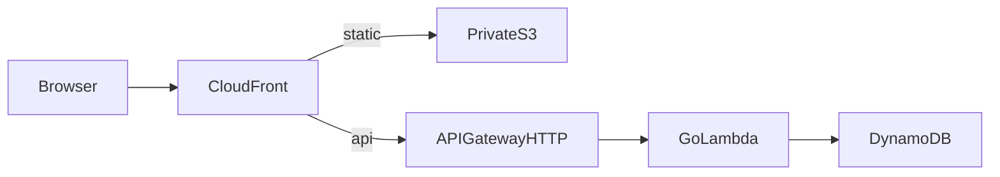

## 需求与约束

- 文章必须构建期生成，访客请求不依赖数据库。
- 反馈与反应等动态数据走 `/api/v1/*`。
- 私有 S3 + CloudFront OAC，不用公开网站托管桶。

## 组件拓扑

## 数据流

1. 作者提交 MDX，CI/本地构建产出 `frontend/out/`。
2. 同步到私有 S3；CloudFront 默认行为回源 S3。
3. `/api/*` 有序行为转发 API Gateway，禁用默认缓存。
4. Lambda 读写 DynamoDB；失败时静态文章仍可阅读。

## 故障路径

- 静态深链依赖 CloudFront Function 补 `index.html`，且不得改写 API 路径。
- API 4xx/5xx 不应被自定义错误页伪装成 200 HTML。

## 替代方案

- 全站 SSR：运维更重，个人博客收益有限。
- 仅用托管平台 Server Actions：与「静态优先 + Go API」目标不一致。
