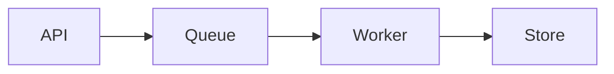

> 本文为管线验证用的**示例文章**，不是站点作者的正式技术分享。阅读优先看后续三篇基于本仓库实现的文章。

这是 OrbitForge 的示例技术文章，用于验证文章详情页的阅读体验：代码高亮、公式与架构图。

## 背景

个人技术博客需要把异步任务执行的设计取舍讲清楚，而不是只贴一张架构图。

## 目标与约束

- 任务可异步执行
- Worker 资源隔离
- 失败可观测、可重试

### 关键指标

可用性优先于极限吞吐。队列积压需要有明确告警阈值。

## 方案选择

优先考虑队列驱动的任务执行模型，在吞吐与复杂度之间做权衡。

```go
type Task struct {
    ID      string
    Payload []byte
}

func (w *Worker) Handle(ctx context.Context, task Task) error {
    return w.executor.Run(ctx, task)
}
```

## 架构示意



## 简单公式

任务重试退避可以写成 $t = t_0 \cdot 2^{n}$，其中 $n$ 为重试次数。

## 小结

本文件为已发布示例；真实文章内容由站点作者后续撰写。
